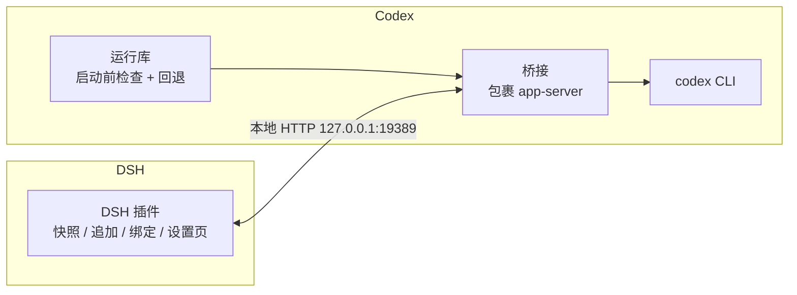

# dsh-codex-native-sync

让 **DeepSeek Harness (DSH)** 与 **Codex** 的两端原生聊天**双向同步**：你在哪边说话，另一边都能看见；换到哪边，都能接着聊。

两端各用自己的模型、各在自己的界面。**这是一个仓库维护、成套使用的 Codex ↔ DSH 同步项目**：DSH 插件负责接入 DSH，Codex 组件负责接入 Codex。

如果你不用 Codex，就不需要安装本项目的 DSH 插件。两个组件一起提供同步功能，Windows 安装流程见下文和安装说明。

DSH STORE 应定位到子目录 `packages/dsh-plugin`，仓库根目录是配套套件，不能作为独立 DSH 插件安装。商城声明、权限与逐版本验收状态见 [DSH STORE 接入说明](docs/DSH-STORE.md)。

**当前发布状态：预览版。** 已验证隔离新库中的原生双向记录、DSH 设置页和重启恢复；Codex 桌面窗口的即时刷新及其他机器组合仍待验证。请先使用测试聊天验收。

Windows 使用者选择带 `windows-x64` 的 Release 附件，其中附带运行库；开发者可选源码包。[下载文件与校验说明](docs/RELEASE.md)。

> ⚠️ **非官方集成。** Codex 侧通过包装它的 CLI 实现，依赖未承诺稳定的 app-server 协议，**Codex 升级后可能失效**。已内置启动前检查与失败回退（失效时 Codex 仍能正常启动，只是不同步）。

---

## 一套项目，两个配套组件

| 组件 | 形态 | 安装位置 |
|---|---|---|
| **DSH 插件** | DSH bundle + 客户端设置页 | DSH profile |
| **Codex 同步组件** | 原生插件 + 运行库 + CLI 桥接 | Codex 所在电脑 |

**完整同步要求两侧都安装、配置正确并运行。** 可以分步安装或更新某一侧；“本次只处理一侧”不能证明另一侧已经装好，也不能证明它缺失。是否可用以第 3 步的实际双向验证为准。

### 配套版本

两个组件使用各自的包版本，属于同一套发布；更新时使用同一个发布包，不要拼接不同提交中的文件。

| 套件源码版本 | DSH 插件 | Codex 组件 |
|---|---|---|
| 0.3.5-preview.1 | `dsh-codex-link` 0.1.4 | `dsh-codex-bridge` 0.3.4 |
| 0.3.4-preview.1 | `dsh-codex-link` 0.1.3 | `dsh-codex-bridge` 0.3.3 |
| 0.3.3-preview.1 | `dsh-codex-link` 0.1.2 | `dsh-codex-bridge` 0.3.2 |
| 0.3.2 | `dsh-codex-link` 0.1.2 | `dsh-codex-bridge` 0.3.2 |
| 0.3.1 | `dsh-codex-link` 0.1.2 | `dsh-codex-bridge` 0.3.1 |
| 0.3.0 | `dsh-codex-link` 0.1.1 | `dsh-codex-bridge` 0.3.0 |

版本组合记录在根目录 `package.json` 的 `syncComponents` 中，安装器在写入前核对两侧源码版本。运行库内部仍标记为 0.2.0，和上表的组件包版本是两回事。**源码版本匹配不等于安装或互通验证已经通过。**



## 仓库结构

```
packages/
  dsh-plugin/         标准 DSH 插件包（宿主半边 + 客户端设置页）
    package.json      dsh.bundle / dsh.client / exports
    client.js         设置页（settings.section）
    lib/index.js      宿主入口
    src/              同步核心、标题同步、采集器
  codex-bridge/       Codex 侧桥接（非官方）
    proxy-v3.mjs      多绑定代理：注入历史 + 推送消息
    history.mjs       账本、ID 规则、轮次合并
    text-sync.mjs     文字同步与发件队列
    src/              原生插件（激活检查、启动前校验）、运行库源码
```

数据存在三处：DSH 原生会话、Codex 原生记录，以及用于绑定和去重的桥接账本。两端各自保留历史，安装或回滚时都应保留这些数据。

---

## 安装前必须知道的限制

1. **需要一次性改 `CODEX_CLI_PATH`**，并**重启一次 Codex**；之后日常开关同步不再需要重启。
2. **默认只同步文字**。可选开启 Codex → DSH 的工具操作记录，会占用 DSH 上下文；不传附件或私有推理。详见[操作记录说明](docs/OPERATIONS.md)。
3. **工作区归属按会话创建时的 `cwd` 计算**。重归属是离线维护操作，必须先正常退出 Codex；旧会话保留，迁移过程和恢复方式见 [维护说明](docs/MAINTENANCE.md)。
4. **Codex 与 DSH 都必须在本机**，跨机器不在支持范围。
5. **当前为公开预览版**。`setup.mjs` 已覆盖文件准备、运行库编译、配置生成和原生插件登记；另一台干净电脑的整套桌面验收仍未完成。请勿将安装状态 `ready` / `activated` 视为实际同步已通过。
6. **已打开的聊天可能延迟显示收到的消息**。可切换到别的聊天再打开核对；记录写入与窗口显示应分别验收，目前未承诺窗口刷新的延迟上限。

---

## 安装步骤

完整路径、所需软件与故障恢复见 [Windows 安装说明](docs/INSTALLATION.md)。请先确认原来使用的 DSH profile 和原生 Codex 程序位置，再正常退出两个客户端。

### 第 1 步：预演并准备文件

在仓库目录打开 PowerShell，替换实际路径：

```powershell
$profileDir = '<实际 DSH profile 目录>'
$nativeCli = '<实际原生 codex.exe 路径>'
$runtimeDir = "$env:LOCALAPPDATA\CodexDshSync"
node setup.mjs --profile "$profileDir" --runtime "$runtimeDir" --native-cli "$nativeCli" --dry
# 核对目录后再执行：
node setup.mjs --profile "$profileDir" --runtime "$runtimeDir" --native-cli "$nativeCli" --apply
```

预演不写入。准备阶段会编译运行库、复制配套代码、生成连接文件与 DSH 登记，完成状态为 `ready`，尚未接管 Codex 启动。

### 第 2 步：接入 Codex

```powershell
node setup.mjs --runtime "$runtimeDir" --activate
```

这一步登记并核对 Codex 原生插件，然后设置用户级启动入口。完成后，正常退出并重新打开 Codex、DSH。

### 第 3 步：确认双向都通

- `<运行目录>/last-launch.json`：应为 `mode: bridge`、`reason: ready`；
- `<运行目录>/data/status-v2.json`：应为 `initialized: true`，各绑定的 `lastError` 为 `null`；首次聊天接入后绑定数增加；
- DSH 设置里出现「Codex 同步」，六个开关可保存；
- 两端各发一句，确认另一端的原生聊天中都出现。

旧 `install.mjs` 仍保留用于已有部署的单侧文件登记或设置已有运行库路径，它不会替代上述完整流程。手工维护和运行库构建见 [维护说明](docs/MAINTENANCE.md)。

### 自动更新

从 `0.3.4-preview.1` 起，完整安装的套件默认每 6 小时检查本项目 GitHub 新版本，自动下载 Windows 包并校验；两端退出后自动安装，下次打开使用新版。聊天过程中只缓存更新，不重启客户端。预览版会接收更新的预览版或正式版；正式版只接收正式版，不降级。

可在 DSH「Codex 同步 → 自动下载并升级」关闭。旧版没有更新器，需要按安装说明手动升级这一次；只复制 DSH 插件不会给 Codex 安装更新器。状态查看、关闭方式和失败恢复见 [自动更新说明](docs/UPDATES.md)。

### 可选操作同步

DSH「Codex 同步 → 同步 Codex 操作步骤到 DSH」默认关闭，需要的人可自行开启。它把开启后新增的工具调用及结果追加为 DSH 原生操作步骤，不倒灌旧操作，也不会在 DSH 重新执行。文字仍双向同步，操作记录仅为 Codex → DSH。开启会增加上下文用量，关闭保留已有记录。范围、截断和维护限制见[操作记录说明](docs/OPERATIONS.md)。

---

## 出问题了先看这里

按顺序排除，多数问题三步内能定位：

1. **看 Codex 侧有没有接管**：`<运行库目录>\last-launch.json` 里 `"mode"` 应为 `bridge`。
   `native` 说明桥接没起来——此时 Codex 能正常用，但同步是停的。
2. **看桥接状态**：`<运行目录>/data/status-v2.json` 的 `initialized` 应为 `true`，各 binding 的 `lastError` 应为 `null`。
3. **看 DSH 侧有没有装好**：设置里有没有「Codex 同步」。
4. **列表是空的**：DSH 启动时没带原来的 `DSH_HOME`，用持久化环境变量固定它。

具体故障的原因与修复过程写在 [CHANGELOG.md](CHANGELOG.md)——那里记的是"为什么"，这里只给"现在怎么办"。

## 开发验证

运行 `npm test`。安装回滚、配置和标题测试无需运行客户端。原生集成测试需要通过 `DSH_TEST_ANCHOR` 指定可读取的 DSH 依赖入口文件，通过 `CODEX_TEST_CLI` 指定原生 Codex CLI 的绝对路径；缺少变量时会明确跳过相应测试。

集成测试使用临时 profile、独立 `CODEX_HOME`、本机假服务和原生会话格式，不写入使用者的聊天，不发起模型请求。它们不等于在另一台电脑完成了桌面安装验收。

Windows 整链路开发测试需要 .NET Framework C# 编译器；可用 `CSC_TEST_PATH` 指定路径。Git 源码不包含运行库二进制，Windows Release 包则附带运行库；构建与配置方法见 [维护说明](docs/MAINTENANCE.md)，验收范围见 [验证记录](docs/VALIDATION.md)。

## 卸载与回滚

使用新安装流程时，先正常退出两个客户端，再运行：

```powershell
node setup.mjs --runtime "$runtimeDir" --rollback
```

恢复本次变更前的文件、登记和启动入口，保留共享库与聊天历史。若配置后来有其他修改，会保留并报告冲突，详见 [安装说明](docs/INSTALLATION.md)。旧手工部署需按自己的备份撤回；不要直接清空共享库或删除账本。

---

## 这个项目是怎么来的

它不是"AI 一键生成"的产物，也不是某个团队的正式项目，而是一次**人机协作的实际记录**：

- **人**：提需求、判断取舍、验收结果、决定何时回滚；
- **两个 AI 代理**：Codex 与 DSH，各自在自己的界面里实现与联调；
- **它们之间传递上下文**，用的正是这个项目本身要解决的问题——早期靠人手工搬运，后来靠这套同步。

所以 [CHANGELOG.md](CHANGELOG.md) 里那些故障不是编的，每一条都在开发中真实发生过并修掉了。

**需要你知道的**：代码由 AI 产出，正确性靠测试与这些故障记录兜底，而不是靠"AI 很聪明"的叙事。使用前建议先读 CHANGELOG，再自己跑一遍上文第 3 步的验证。

---

## 许可

MIT
